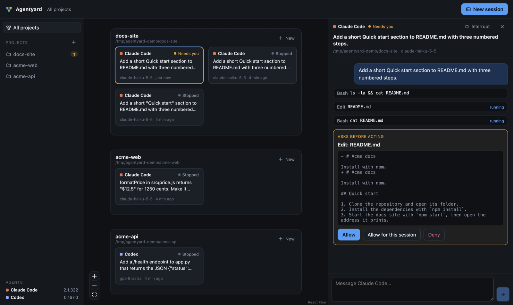
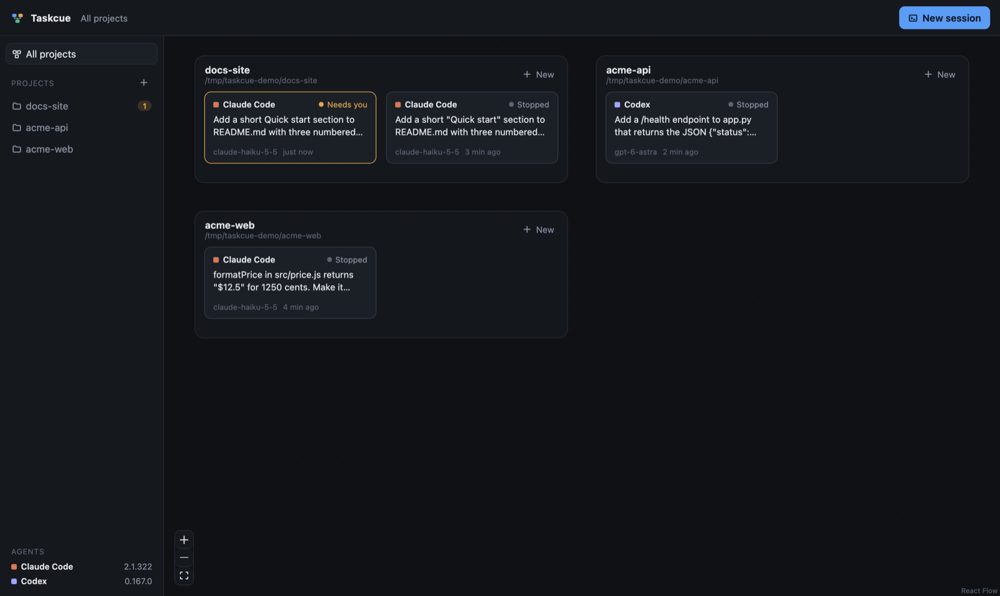

# Taskcue

**A visual canvas for the coding agents already on your computer.** Claude Code and Codex sessions side by side on one
board, grouped by project. See what each one is doing, answer what it asks, and talk to any of them from one place.



Taskcue doesn't have its own model and doesn't sell AI usage. It drives the agents you have installed: the real `claude`
and `codex` programs, with your own sign-in, settings, memory files, skills and MCP servers. A session started here is
the same session you'd get in a terminal, and you can continue it there.

## What it does

- **One board for every agent.** Each project folder is a frame; each session is a card with its agent, its state
  (working, needs you, ready, stopped) and what it was asked.
- **Claude Code and Codex, side by side.** Start either in any project, pick its model, and choose how much it may do
  without asking.
- **Approvals in one place.** When an agent wants to run a command or edit a file, the card turns amber and the panel
  shows exactly what it wants to do: Allow, Allow for this session, or Deny.
- **Your existing sessions too.** Recent conversations from Claude Code's and Codex's own history appear on the board.
  Open one to read it; send a message to continue it.
- **Local only.** The server listens on `127.0.0.1` and checks a secret token on every call, so other websites and
  programs on your computer can't drive your agents.



## Requirements

- Node.js 22 or newer and [pnpm](https://pnpm.io)
- At least one agent, installed and signed in:
  - **Claude Code**: [install it](https://code.claude.com), then run `claude` once to sign in.
  - **Codex**: `npm install -g @openai/codex`, then `codex login`. (On macOS, the copy inside the ChatGPT desktop app
    is found too.)
- macOS or Linux. Windows is untested.

## Quick start

```bash
git clone https://github.com/taskcue/taskcue.git
cd taskcue
pnpm install
pnpm dev
```

Open the address it prints; it ends in `#token=…`. That's it.

For a production build: `pnpm build && pnpm start`.

### Settings

| Variable | Default | What it does |
|---|---|---|
| `TASKCUE_PORT` | `4880` | The port the server listens on (always `127.0.0.1`). |
| `TASKCUE_DATA_DIR` | `~/.taskcue` | Taskcue's own state: settings, the session list, the token. |
| `TASKCUE_HISTORY` | on | `0` keeps sessions from the agents' own history off the board. |
| `TASKCUE_CLAUDE_BIN` | found on `PATH` | The `claude` binary to use. |
| `TASKCUE_CODEX_BIN` | found on `PATH` | The `codex` binary to use. |

## Permissions

Each session starts in one of three modes, mapped onto each agent's own settings:

| Mode | Claude Code | Codex |
|---|---|---|
| **Ask first** (default) | `default` permission mode | `untrusted` approvals, workspace-write sandbox |
| **Edit freely** | `acceptEdits` | `on-request` approvals, workspace-write sandbox |
| **Full access** | `bypassPermissions` | no approvals, no sandbox |

Full access means the agent can run anything without asking. Use it only in a folder you'd trust it with.

## How it works

```
browser (React, React Flow)  ──HTTP + SSE──▶  server (Node, no framework)
                                                │
                                                ├─ adapters/claude ──stdio, stream-json──▶  claude -p …
                                                └─ adapters/codex  ──stdio, JSON-RPC────▶  codex app-server
```

Each agent sits behind one small interface (`server/agents/types.ts`): start or resume a session, send a message,
interrupt, answer an approval, read history. An adapter translates its agent's own events into Taskcue's (messages,
tool calls, approvals) and the rest of the app never sees an agent's wire format. Conversations stay where each agent
keeps them (`~/.claude/projects`, `~/.codex/sessions`); Taskcue only remembers which sessions are on the board.

More in [docs/architecture.md](docs/architecture.md). Adding another agent (Gemini CLI, OpenCode, anything that speaks
the [Agent Client Protocol](https://agentclientprotocol.com)) is one adapter:
[docs/adding-an-agent.md](docs/adding-an-agent.md).

## Your accounts

Taskcue runs each agent's own, unmodified program, and you sign in to it the agent's own way. Taskcue never reads,
stores or forwards your credentials, and your usage is billed to your own account under your agreement with that
provider. It is not affiliated with or endorsed by Anthropic or OpenAI; "Claude Code" and "Codex" are their trademarks.

## Roadmap

- What needs you: one page with every session waiting on you, across agents and projects
- More agents through the [Agent Client Protocol](https://agentclientprotocol.com): Gemini CLI, OpenCode, Goose and others
- Continue a conversation in another agent, with a hand-off summary
- Arrange cards freely and keep the layout
- Sessions that keep running when the server restarts
- A desktop app

## Contributing

Issues and ideas are very welcome. See [CONTRIBUTING.md](CONTRIBUTING.md) before opening a pull request.

## License

[AGPL-3.0](LICENSE). You can use, change and share Taskcue freely; if you run a changed version as a service for
others, you share your changes under the same license.
